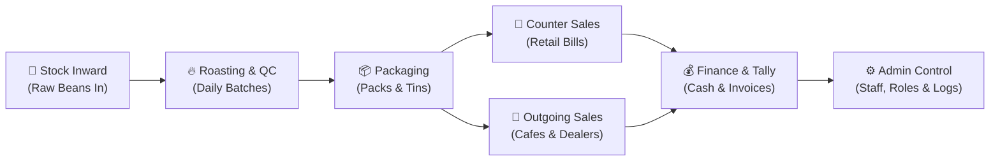
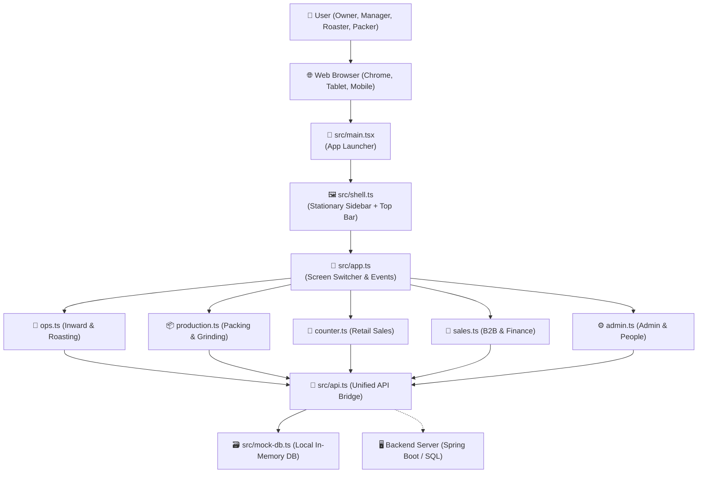
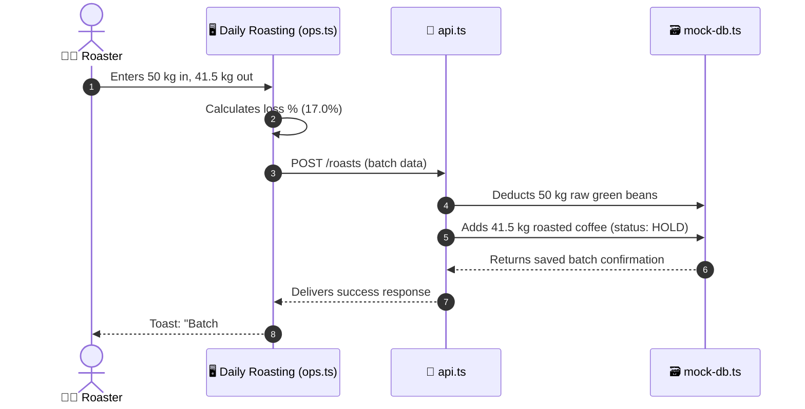
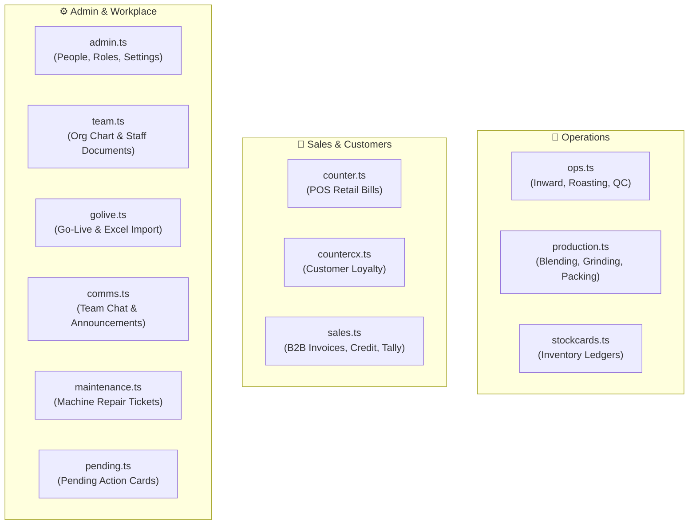
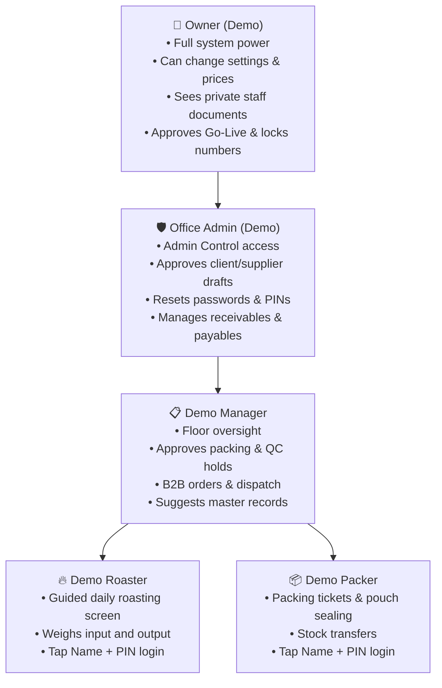

# Vasavi Trading Company (VTC) CRM — Codebase & File Structure Guide

> **Welcome!** This guide explains how the entire VTC CRM application works in plain, simple words that anyone can understand—even if you have never written a line of code.
> Every section includes **both an ASCII visual diagram** (visible in any plain text editor) and a **Mermaid diagram** (for GitHub and rich markdown previewers).

---

## ☕ 1. Big Picture: What is this Project?

Think of this software as the **central nervous system of a coffee business**. 
Just like a real coffee factory has different departments working together under one roof:

1. **Warehouse**: Bags of raw green coffee beans arrive from auctions and plantations.
2. **Roastery**: Head roasters roast batches in the machine and check quality (QC).
3. **Packaging**: Roasted beans and powders are packed into pouches and sealed.
4. **Counter & Sales**: Retail counter sells fresh coffee to walk-in customers; sales team ships bulk orders to cafés and dealers.
5. **Accounts & Admin**: Tracking payments, GST invoices, staff permissions, and store settings.

This software automates and connects all five areas so that **no coffee, no money, and no bag is ever lost**.

### 📊 Business Flow Diagram (Plain Text / ASCII)

```
┌─────────────────────┐      ┌─────────────────────┐      ┌─────────────────────┐
│   🌾 Stock Inward   │ ───> │  🔥 Roasting & QC   │ ───> │    📦 Packaging     │
│ (Raw Green Beans In)│      │   (Daily Batches)   │      │   (Packs & Tins)    │
└─────────────────────┘      └─────────────────────┘      └─────────────────────┘
                                                                     │
                                    ┌────────────────────────────────┴───────────────────────────────┐
                                    │                                                                │
                                    ▼                                                                ▼
                         ┌─────────────────────┐                                          ┌─────────────────────┐
                         │  🏪 Counter Sales   │                                          │  🚚 Outgoing Sales  │
                         │   (Retail POS Bills)│                                          │  (Cafés & Dealers)  │
                         └─────────────────────┘                                          └─────────────────────┘
                                    │                                                                │
                                    └────────────────────────────────┬───────────────────────────────┘
                                                                     │
                                                                     ▼
                                                          ┌─────────────────────┐
                                                          │ 💰 Finance & Tally  │
                                                          │  (Cash & Invoices)  │
                                                          └─────────────────────┘
                                                                     │
                                                                     ▼
                                                          ┌─────────────────────┐
                                                          │  ⚙️ Admin Control   │
                                                          │  (Staff, Security)  │
                                                          └─────────────────────┘
```

### 📈 Business Flow Diagram (Mermaid)



---

## 🏗️ 2. How the Software is Built (System Architecture)

The application is built as a **Single Page Application (SPA)** using **TypeScript, HTML5, CSS3, and Vite**. It is designed to work completely offline in the browser using an intelligent in-memory **Mock Database**, while being 100% ready to talk to a Spring Boot / PostgreSQL backend server.

### 📊 Architecture Flow Diagram (Plain Text / ASCII)

```
[ 👤 User: Owner / Admin / Manager / Roaster / Packer ]
                       │
                       ▼
[ 🌐 Browser Window: Chrome / Edge / Android Tablet / Mobile ]
                       │
                       ▼
[ 🚀 src/main.tsx : Master Entry Bootstrapper ]
                       │
                       ▼
[ 🖼️ src/shell.ts : Stationary Sidebar, Top Bar, Profile Capsule, Idle Logout ]
                       │
                       ▼
[ 🧭 src/app.ts : Central Router, Click/Submit Handlers, Page Switcher ]
        │                 │                 │                 │
        ▼                 ▼                 ▼                 ▼
[ 🌾 ops.ts ]     [ 📦 prod.ts ]     [ 🏪 counter.ts ] [ ⚙️ admin.ts ]
        │                 │                 │                 │
        └─────────────────┼─────────────────┴─────────────────┘
                          │
                          ▼
            [ 🔌 src/api.ts : API Courier ]
                 │                    │
        (offline/local)        (production server)
                 ▼                    ▼
      [ 🗃️ src/mock-db.ts ]   [ 🖥️ Spring Boot API ]
```

### 📈 Architecture Flow Diagram (Mermaid)



---

## 📂 3. Directory Map at a Glance

```
vtc-crm/
├── 📁 backend/                <-- Java Spring Boot 3 & MySQL Backend
│   ├── 📄 pom.xml             <-- Maven dependencies (Security, JPA, MySQL, JJWT)
│   └── 📁 src/main/java/com/vtc/crm/
│       ├── 🚀 VtcCrmApplication.java
│       ├── 📁 config/         (SecurityConfig, JwtUtil, JwtAuthenticationFilter)
│       ├── 📁 controller/     (Auth, StaffManagement, Catalog, Operations, Audit)
│       ├── 📁 entity/         (User, UserProfile, UserDocument, AuditLog, Masters)
│       ├── 📁 repository/     (Spring Data JPA Repositories)
│       └── 📁 service/        (AuthService, StaffService, DataInitializer)
│
├── 📁 frontend/               <-- Vite + TypeScript Single Page Application
│   ├── 📄 index.html          <-- Main web page template
│   ├── 📄 package.json        <-- Frontend dependencies
│   ├── 📄 vite.config.ts      <-- Proxy /api -> http://127.0.0.1:8080
│   ├── 📁 public/             <-- Static assets, icons, fonts
│   └── 📁 src/                <-- Frontend UI Source Code
│       ├── 🚀 main.tsx        <-- Starting entry point
│       ├── 🧭 app.ts          <-- Central coordinator & page switcher
│       ├── 🔌 api.ts          <-- Unified API courier to Spring Boot
│       ├── 🔐 login.ts        <-- Staff PIN & password sign-in
│       ├── 🖼️ shell.ts        <-- Stationary sidebar, top bar & navigation
│       ├── 📊 state.ts        <-- Current session & reactive memory
│       ├── 🎨 ui.ts           <-- Reusable dialogs, tables & inputs
│       ├── 📁 views/          <-- 14 coffee factory screens
│       └── 📁 styles/         <-- Warm coffee palette & layout rules
│
├── 📄 CODEBASE_GUIDE.md       <-- Complete architecture & plain-language guide
└── 📄 CODEBASE_GUIDE.html     <-- Interactive guide with live Mermaid diagrams
```

---

## 🔍 4. Every File Explained in Plain Words

### 🏢 A. Core Application Engine (The Heart)

These files load the app, remember who is logged in, and handle navigation.

| File | What it does in simple words | Real-world coffee analogy |
| :--- | :--- | :--- |
| `src/main.tsx` | **The Master Key**. The very first file executed when opening the website. It boots the portal, starts the clock, and attaches the bottom demo reset pill. | Unlocking the factory gates in the morning. |
| `src/app.ts` | **The Floor Supervisor**. Listens to every click, keypress, and form submission. Decides which screen to show on the monitor. | The floor manager directing staff where to go. |
| `src/shell.ts` | **The Physical Building**. Renders the stationary left sidebar, user profile capsule, breadcrumbs at the top, language picker, and the auto-logout timer. | The reception area, signs on the walls, and hallways. |
| `src/state.ts` | **The Brain's Memory**. Remembers who is signed in (`Owner`, `Manager`, `Roaster`, `Packer`), what permissions they hold, and what page they are viewing. | A person's clipboard holding today's active work notes. |
| `src/ui.ts` | **The Toolbox**. A collection of building blocks used across all pages: pop-up dialogs, tables, input boxes, status tags (`ACTIVE`, `HOLD`), and toast alerts. | Standard measuring cups, pens, and stamps used in every room. |

---

### 🔌 B. Data & Network Layer (The Records)

| File | What it does in simple words | Real-world coffee analogy |
| :--- | :--- | :--- |
| `src/api.ts` | **The Office Courier**. Sends and receives data between the screens and the database. If the internet or server is offline, it instantly routes data to `mock-db.ts` so the user never faces a broken screen. | The internal mail clerk carrying order slips between departments. |
| `src/mock-db.ts` | **The Browser Ledger**. Holds realistic coffee beans, users, invoices, cash transactions, and warehouse stock right inside your browser memory. | A sample practice ledger loaded with real business numbers. |

### 📊 Batch Recording Workflow (Plain Text / ASCII)

```
[ 👨‍🍳 Roaster ] ──> Enters 50 kg green coffee in, 41.5 kg roasted out
                         │
                         ▼
[ 🖥️ ops.ts ] ──────> Automatically calculates 17.0% roast loss
                         │
                         ▼
[ 🔌 api.ts ] ──────> POST /roasts (batch payload)
                         │
                         ▼
[ 🗃️ mock-db.ts ] ──> Deducts 50 kg raw beans, adds 41.5 kg roasted (HOLD)
                         │
                         ▼
[ 🖥️ ops.ts ] <────── Success response delivered
                         │
                         ▼
[ 👨‍🍳 Roaster ] <──── Green Toast Alert: "Roast batch #3 saved!"
```

### 📈 Batch Recording Workflow (Mermaid)



---

### 📱 C. Screen Views (`src/views/`)

Each file here controls one specific section or department of the business.

### 📊 Department & Screen Map (Plain Text / ASCII)

```
┌────────────────────────────────────────────────────────────────────────┐
│                        🌾 OPERATIONS DEPARTMENT                        │
├──────────────────┬──────────────────────┬──────────────────────────────┤
│  ops.ts          │  production.ts       │  stockcards.ts               │
│  Inward bags,    │  Blending ratios,    │  Live inventory stock ledger,│
│  Roasting, QC    │  Grinding, Packing   │  reorder alert levels        │
└──────────────────┴──────────────────────┴──────────────────────────────┘

┌────────────────────────────────────────────────────────────────────────┐
│                          🏪 SALES DEPARTMENT                           │
├──────────────────┬──────────────────────┬──────────────────────────────┤
│  counter.ts      │  countercx.ts        │  sales.ts                    │
│  Retail POS,     │  Customer directory, │  B2B wholesale, Invoices,    │
│  Cash/UPI billing│  Loyalty & history   │  Credit aging, Tally export  │
└──────────────────┴──────────────────────┴──────────────────────────────┘

┌────────────────────────────────────────────────────────────────────────┐
│                     ⚙️ ADMIN & WORKPLACE MANAGEMENT                    │
├──────────────────┬──────────────────────┬──────────────────────────────┤
│  admin.ts        │  team.ts             │  golive.ts                   │
│  People, Roles,  │  Org chart tree,     │  Go-live setup, Opening dues,│
│  Settings, Audit │  Staff ID documents  │  Excel template import       │
├──────────────────┼──────────────────────┼──────────────────────────────┤
│  pending.ts      │  comms.ts            │  maintenance.ts              │
│  Top notice banner│ Internal team chat,  │ Machine breakdown tickets &  │
│  and task alerts │ announcements        │ repair schedule              │
└──────────────────┴──────────────────────┴──────────────────────────────┘
```

### 📈 Department & Screen Map (Mermaid)



#### Detailed Breakdown of Each View:

1. **`src/views/ops.ts` — Roastery Operations & Inward**
   - **What it does**: Handles the arrival of green coffee bags (Stock Inward), daily roasting batches, calculating roast weight loss percentage, and placing lots on Quality Hold until cup testing is approved.
   - **Key Features**: Auto-calculates moisture and weight loss; enforces DPR rules so under-roasted or over-roasted coffee is flagged.

2. **`src/views/production.ts` — Blending, Grinding & Packing**
   - **What it does**: Controls blending pure coffee with chicory (e.g. 70/30 or 80/20 blends), sending roasted coffee to the grinder, and packing powder into 250g, 500g, or 1kg pouches.

3. **`src/views/counter.ts` — Retail Counter Sales**
   - **What it does**: The fast Point of Sale (POS) touchscreen for walk-in customers. Staff tap quick product tiles (Filter coffee 70/30, Pure powder, Assam tea), choose weight in grams, select Cash or UPI QR, and print a bill.
   - **Security**: Includes manager PIN protection to open the cash drawer or see today's cash totals.

4. **`src/views/countercx.ts` — Retail Customers & Loyalty**
   - **What it does**: Stores repeat customer phone numbers, visits, and total money spent. Staff can look up regular customers in seconds.

5. **`src/views/sales.ts` — B2B Orders, Customer Credit & Finance**
   - **What it does**: Manages wholesale commercial orders for cafés and dealers. Tracks unpaid customer invoices, overdue aging buckets (1–30 days, 31–60 days, 60+ days), supplier payables, and exports clean entries directly to Tally accounting software.

6. **`src/views/stockcards.ts` — Real-Time Inventory Cards**
   - **What it does**: Shows live stock levels across raw beans, roasted beans, blends, and packed bags at every location (`PROD-01`, `CTR-01`). Alerts managers when stock dips below safe minimums.

7. **`src/views/admin.ts` — Admin Control Hub**
   - **What it does**: The security room of the software. Admins add users, assign PINs/passwords, manage roles, adjust company settings (quiet hours, invoice prefixes), and view an uneditable audit log of every action taken.

8. **`src/views/catalogue.ts` — Master Catalog**
   - **What it does**: Master directory of approved Clients, Coffee Suppliers, Bean Products, and Roast Profiles. Staff can suggest new names, but only admins can approve them into active status.

9. **`src/views/golive.ts` — Go-Live Setup**
   - **What it does**: Used when launching the software for the first time. Lets the owner upload an Excel workbook with existing clients, suppliers, opening bean stock, and old credit dues. Locks opening numbers once the owner presses **"We're live"**.

10. **`src/views/team.ts` — Company Org Chart & Confidential Documents**
    - **What it does**: Draws an interactive top-down family tree of who reports to whom. For the owner and admin, it safely stores employee ID cards, Aadhaar, PAN, and bank details (showing only the last 4 digits for privacy).

11. **`src/views/pending.ts` — "Pending Here" Action Cards**
    - **What it does**: The orange notification banner at the top of each screen showing jobs waiting for review (e.g. "1 suggested record to approve", "Roast 3 batches").

12. **`src/views/comms.ts` — Internal Team Messaging**
    - **What it does**: Workplace chat allowing staff, roasters, and managers to message each other or broadcast urgent announcements to specific floor groups.

13. **`src/views/maintenance.ts` — Equipment & Machine Upkeep**
    - **What it does**: Allows roastery workers to report broken sealer machines, grinder maintenance, or roaster cleaning tasks so machines never break down unexpectedly.

14. **`src/views/profile.ts` — User Preferences & Role Switcher**
    - **What it does**: Lets the signed-in user change their display language, toggle large text for factory tablets, or switch between demo personas (`Owner`, `Manager`, `Roaster`, `Packer`).

---

### 🎨 D. Stylesheets (`src/styles/`)

| File | What it does in simple words |
| :--- | :--- |
| `src/styles/preview-theme.css` | **The Coffee Theme & Visual Polish**. Defines the rich coffee brown branding (`#422215`, warm tan backgrounds, elevated white cards). Manages custom thin vertical scrollbars and guarantees zero unwanted horizontal scrolling. |
| `src/styles/app.css` | **Base Layout & Structure**. Handles flexbox grids, responsive breakpoints for tablets, modal dialog overlays, and typography. |
| `src/styles/glass-crm.css` | **Modern Accents**. Provides subtle glass-like translucent effects and card shadows. |

---

### 🛠️ E. Utilities & Helper Tools

| File | Purpose |
| :--- | :--- |
| `src/icons.ts` | Renders clean SVG line icons (coffee cup, flame, shopping cart, user, lock) without loading bulky external font files. |
| `src/i18n.ts` | Instant language switcher supporting **English**, **Telugu (తెలుగు)**, and **Hindi (हिन्दी)**. |
| `src/help.ts` & `src/helptext.ts` | Helpful audio button and explanations attached to headers and badges so new staff can tap and learn how a section works. |
| `src/fx.ts` | Micro-animations, page transitions, and smooth modal fade-ins. |
| `src/vendor/jsqr.mjs` | Camera QR scanner for scanning coffee batch labels on tablet webcams. |
| `src/vendor/qrcode.js` | Generates dynamic UPI QR codes on bills so customers can scan and pay with PhonePe/GooglePay. |
| `src/vendor/motion.min.js` | Physics-based animation engine for smooth dropdowns and popups. |

---

## 👥 5. User Roles & Access Hierarchy

### 📊 Roles & Powers (Plain Text / ASCII)

```
                            ┌───────────────────────────────────┐
                            │          👑 OWNER (DEMO)          │
                            │  • Full system control            │
                            │  • Locks opening balances         │
                            │  • Views confidential employee ID │
                            └─────────────────┬─────────────────┘
                                              │
                                              ▼
                            ┌───────────────────────────────────┐
                            │      🛡️ OFFICE ADMIN (DEMO)       │
                            │  • Admin Control Hub              │
                            │  • Password & PIN resets          │
                            │  • Approves draft clients         │
                            └─────────────────┬─────────────────┘
                                              │
                                              ▼
                            ┌───────────────────────────────────┐
                            │         📋 DEMO MANAGER           │
                            │  • Daily roasting oversight       │
                            │  • B2B orders & dispatch tickets  │
                            │  • Release quality holds          │
                            └─────────┬───────────────┬─────────┘
                                      │               │
                     ┌────────────────┘               └────────────────┐
                     ▼                                                 ▼
      ┌─────────────────────────────┐                   ┌─────────────────────────────┐
      │       🔥 DEMO ROASTER       │                   │        📦 DEMO PACKER       │
      │  • Guided roasting screen   │                   │  • Packing pouch tickets    │
      │  • Weigh input & output     │                   │  • Seal bags & tins         │
      │  • Tap Name + PIN login     │                   │  • Tap Name + PIN login     │
      └─────────────────────────────┘                   └─────────────────────────────┘
```

### 📈 Roles & Powers (Mermaid)



---

## 💡 Summary Cheat Sheet

- Want to change **Retail Counter billing**? 👉 Look in [`src/views/counter.ts`](file:///c:/Users/Asus/Documents/vtc-crm/src/views/counter.ts).
- Want to change **Roasting or QC rules**? 👉 Look in [`src/views/ops.ts`](file:///c:/Users/Asus/Documents/vtc-crm/src/views/ops.ts).
- Want to change **Users, PINs or Roles**? 👉 Look in [`src/views/admin.ts`](file:///c:/Users/Asus/Documents/vtc-crm/src/views/admin.ts).
- Want to change **Sample Demo Data**? 👉 Look in [`src/mock-db.ts`](file:///c:/Users/Asus/Documents/vtc-crm/src/mock-db.ts).
- Want to tweak **Colors, Buttons or Scrollbars**? 👉 Look in [`src/styles/preview-theme.css`](file:///c:/Users/Asus/Documents/vtc-crm/src/styles/preview-theme.css).
