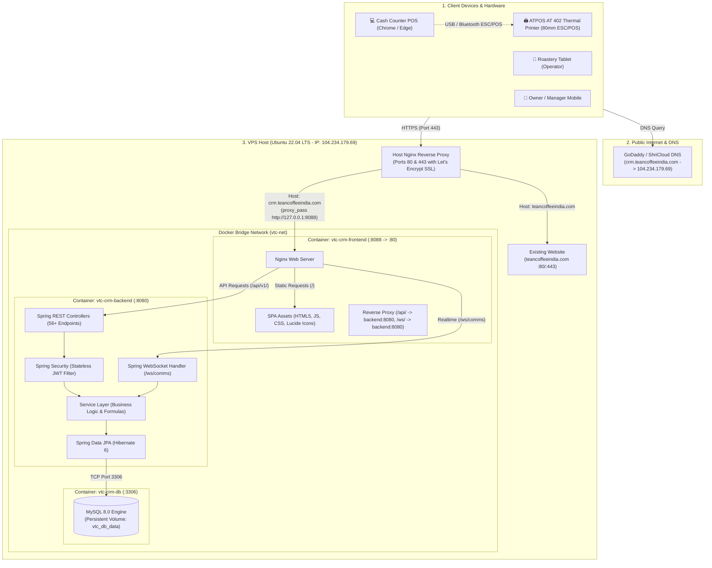
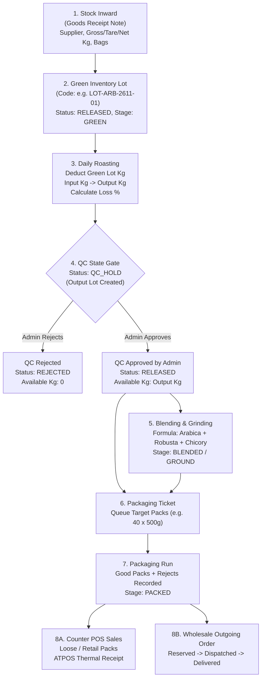
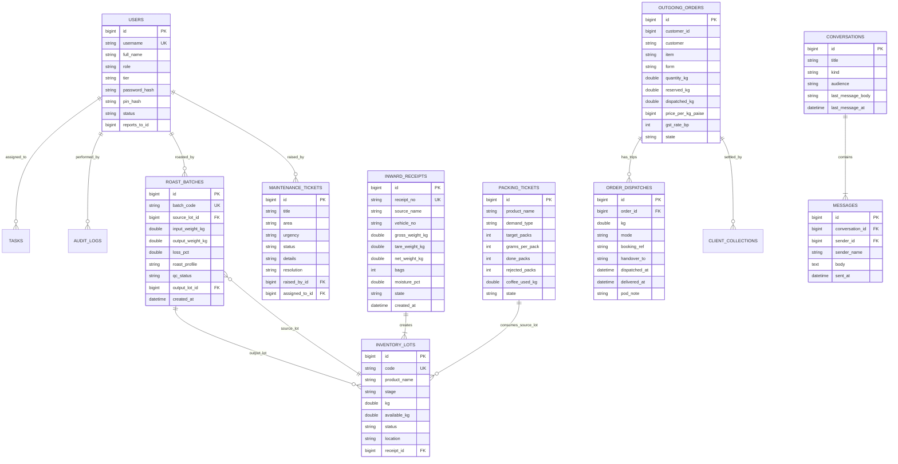
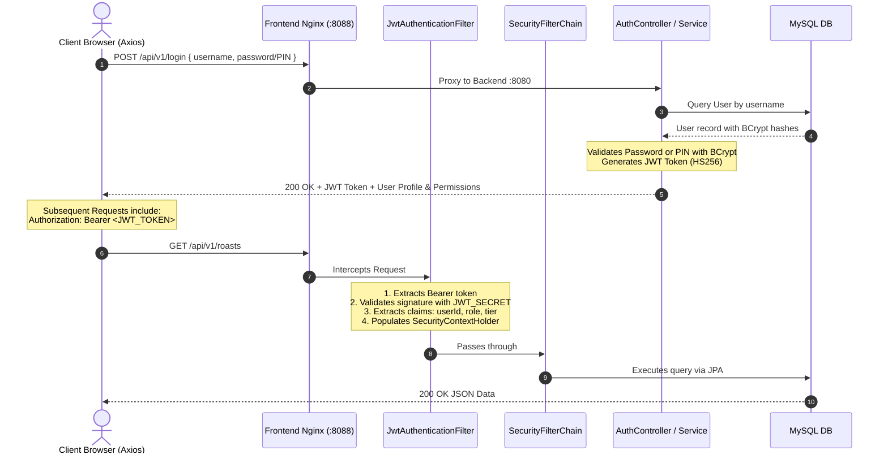
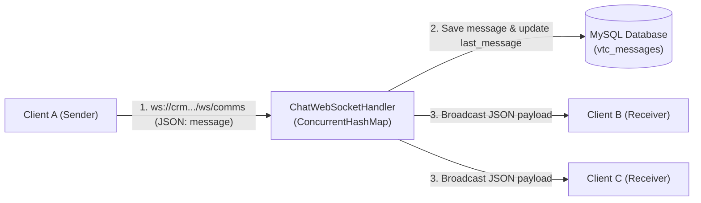

# Vasavi Trading Company (VTC) CRM & ERP — System Design Document

**System Version:** 2.0.0 (Production Architecture)  
**Author:** Vasavi Trading Company Engineering  
**Target Environment:** VPS Deployment with Docker & Subdomain Routing  
**Primary Domain:** `https://crm.teancoffeeindia.com` (Internal Port `8088`)  

---

## 1. Executive Summary & Business Scope

Vasavi Trading Company (VTC) operates a commercial coffee processing, roasting, wholesale merchant, and counter sales facility. The VTC CRM & ERP application is an end-to-end operational operating system designed to eliminate manual paper registers, prevent inventory shrinkage, automate quality control, and enforce strict separation of duties across cash and inventory.

### Key Operational Capabilities
1. **Stock Inward:** Raw green coffee receipt, gate entries, gross/tare/net scale weighing, moisture/defect analysis, lot generation.
2. **Inventory Management:** Real-time stock ledgers across 4 stages (`GREEN`, `ROASTED`, `BLENDED`, `PACKED`) and 4 locations (`PROD-01`, `CTR-01`, `IN_TRANSIT`, `SUPPLIER`).
3. **Daily Roasting:** Batch roasting execution, automatic green bean lot deduction, roast loss % calculation, profile temperature tracking, cooling, and QC hold handover.
4. **Quality Control (QC):** Administrative approval/rejection gates preventing unapproved roasted batches from entering packaging or sales.
5. **Blending & Grinding:** Multi-origin formulations (Arabica/Robusta/Chicory), scale weight confirmation, grinding burr settings.
6. **Packaging:** Packaging ticket queues, target pack execution, run recording, good packs vs rejects reconciliation.
7. **Counter Sales (POS):** Fast counter checkout, loose coffee weighing, custom blend calculations, cash drawer float tracking, and ESC/POS thermal receipt printing on ATPOS AT 402 printers.
8. **Outside Roasting (Job-Work):** Customer-supplied coffee roasting, weight loss tracking, and service billing.
9. **Outgoing Sales & Dispatch:** B2B orders, credit approvals, multi-trip dispatches (Rapido, Uber, vehicle), digital delivery confirmation & POD.
10. **Finance & Tally:** Receivables aging (0–30, 31–60, 60+ days), collections verification, supplier payables matching, and TallyPrime XML/CSV export.
11. **Internal Comms:** Live bi-directional chat, team announcements, voice notes, and WebSocket broadcasts.
12. **Maintenance:** Machine and facility repair tickets, urgency tagging, and resolution tracking.

---

## 2. High-Level Architecture Diagram

---

## 3. Coffee Production & Inventory State Machine

The core business follows a strict linear state machine to maintain mathematical reconciliation of all inventory weights:

---

## 4. Database Entity-Relationship (ER) Architecture

The backend database runs on MySQL 8.0, composed of 18 relational tables managed via Hibernate:

---

## 5. Security & Authentication Architecture

---

## 6. Real-Time WebSocket Communication Architecture

The system features real-time messaging across teams without polling:

---

## 7. Thermal Receipt Printing Subsystem (ATPOS AT 402)

* **Physical Paper Width:** `79.5 ± 0.5 mm` (Standard 80mm roll).
* **Printable Area:** `72.0 mm` (576 dots / 40 monospace characters per line).
* **Driver Architecture:** Dual-mode implementation:
  1. **Direct Web Bluetooth ESC/POS:** Streams binary commands directly to the thermal print head (`\x1b\x40` reset, `\x1b\x21` styling, `\x1d\x56\x42\x00` paper auto-cut).
  2. **High-Precision Browser CSS Print:** Standardized `@page { size: 80mm auto; margin: 0; }` with a 12mm trailing footer padding to protect the receipt text from being clipped by the automatic paper guillotine cutter.
